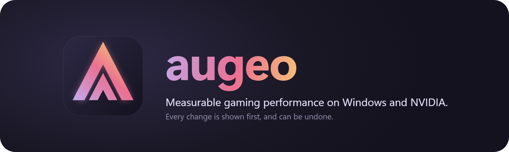

<h1 align="center">
  
</h1>

<p align="center">
  <a href="https://github.com/0xalperen/augeo/releases"></a>
  <a href="LICENSE"></a>
  
</p>

**Real, measurable gaming performance and latency gains on Windows with NVIDIA GPUs. Free and open source, and every change can be undone.**

Most tweak tools sell you hundreds of settings you can't inspect, and no proof that any of them work. augeo goes the other way:

- **Every change is shown before it happens,** with the exact key, old value and new value.
- **Every tweak states its evidence,** and the Myths screen lists popular ones that don't hold up, and why.
- **You can test tweaks yourself.** The built-in benchmark measures your noise floor, and says so when a result is within it.
- **Undo restores your exact old value,** offline, with no account.
- **It finds harmful settings left by older tweak guides,** and can put them back.
- **Nothing stays running.** No service, kernel driver, telemetry or network code.

> **Status: pre-release, tested on one PC.** v0.1.0 hasn't finished its test list, and benchmarks haven't been run in real games yet. Performance claims will only be published here once they've been measured. See [what's been tested](#whats-been-tested).

## Disclaimer

augeo is provided "as is", without warranty of any kind, express or implied. It changes Windows and NVIDIA driver settings. The author and repository owner, and contributors, are not liable for any harm, damage, data loss, instability or other consequences from using it, including effects on games, anti-cheat systems or game accounts. You are responsible for your own system. Full terms are in the GPL-3.0 license, sections 15 and 16.

## How it works

augeo is a single program that runs in your terminal. It carries a catalog of tweaks as plain data, which you can [read in this repo](catalog/).

1. It reads your system's real state, so it knows what's applied, even if Windows or a driver update changed it since.
2. You pick tweaks. It shows the exact changes, the risks, and how sure anyone is that they work.
3. It records every old value to disk before changing anything, then reads each value back to confirm it took.
4. If it's interrupted, even by a power cut, it works out what happened on the next start and helps you recover.

Design details are in [ARCHITECTURE.md](ARCHITECTURE.md).

## Requirements

- Windows 10 version 2004 or newer, or Windows 11
- An NVIDIA GPU for the GPU tweaks. AMD and Intel CPUs are both supported
- A terminal window of at least 80x24. Windows Terminal or the classic console both work. Setting `NO_COLOR` turns colour off
- Administrator rights to apply changes. Browsing and checks need none

## Installation

Download from [Releases](https://github.com/0xalperen/augeo/releases). There's nothing to install, so you just run it, and deleting it removes the program. Your undo history stays in `%ProgramData%\augeo`.

- **`augeo-<version>-windows-x64.zip`:** augeo plus PresentMon, needed for benchmarking
- **`augeo.exe`:** on its own, if you don't need benchmarks

Check downloads against `SHA256SUMS.txt`. Windows SmartScreen will warn you, because the exe isn't code-signed yet. Antivirus tools may also flag it, since it changes system settings. The source is here for you to read, and each release has build provenance you can verify with GitHub.

To build from source, you need Rust and the Visual Studio C++ build tools:

```bash
cargo build --release -p augeo
```

## First run

1. Run `augeo.exe` from a terminal, and read and accept the disclaimer. It's shown again if its text ever changes.
2. Run `auge!check`. It finds what matters most, such as RAM below its rated speed or a monitor at the wrong refresh rate, and it changes nothing.
3. Browse the components. Each tweak shows its danger level, evidence, risks and sources.
4. Before your first change, augeo offers to create a restore point, and tells you whether Windows really made one.

## Usage

Everything works by keyboard, by mouse and by command.

### Keyboard

| Key | Action |
|---|---|
| Up, Down, PgUp, PgDn, Home, End | Move and scroll |
| Tab, Shift+Tab, Left, Right | Switch pane |
| Space | Tick a tweak |
| Enter | Open its exact changes |
| `a` / `d` / `u` | Apply / dry run / undo |
| `o` | Change a tweak's option |
| `r` | Read the system's state again |
| `e` | Elevate |
| `/` or `:` | Type a command |
| `?` or F1 | Help |
| Esc | Back or cancel. It never confirms anything |
| `q` | Quit |

### Mouse

Click rows, checkboxes, buttons and the command bar. What's under the pointer lights up. The wheel scrolls whatever is under the pointer. Double-click a tweak to open its changes. A button fires when you release over it, so sliding off cancels.

### Commands

Press `/`, then type. Tab completes what you've started:

| Command | What it does |
|---|---|
| `auge!help` | Lists everything |
| `auge!cpu` | Opens a component |
| `auge!cpu#1` | Applies a tweak, after showing its changes and asking |
| `auge!cpu#1-2` | Applies a range |
| `auge!gpu#1,3` | Applies a list |
| `auge!gpu#1-3,5` | Applies a mix |
| `auge!dry gpu#1-3` | Shows the changes without making them |
| `auge!info gpu#1` | Shows a tweak's details |
| `auge!status` | Lists every tweak's real state |
| `auge!undo gpu#1` | Undoes a tweak |
| `auge!undo-all` | Undoes everything |
| `auge!preset recommended` | Applies the preset, after showing its changes |
| `auge!check` | Runs the read-only system report |
| `auge!myths` | Lists what augeo deliberately doesn't do |
| `auge!game cs2.exe` | Picks a game for per-game tweaks |
| `auge!game#1@cs2.exe` | Applies a per-game tweak |
| `auge!bench` | Benchmarking, see below |
| `auge!timer` | Timer resolution tool |
| `auge!polling` | Measures your mouse's polling rate, in a small window you click to start |
| `auge!restore-point` | Creates a restore point |
| `auge!elevate` | Opens an elevated window |
| `auge!reboot` | Offers to restart. augeo never restarts by itself |
| `auge!log` | Shows the log |
| `auge!quit` | Quits |

Mistakes get a helpful answer, such as `unknown component 'cpuu'. Did you mean 'cpu'?` or `tweak #7 doesn't exist in cpu (it has 1-2)`.

`auge!status`, `auge!check` and `auge!help` also work from the command line, as in `augeo "auge!status"`. Changes only happen inside the app, and there's deliberately no option to skip confirming.

Tweak numbers are permanent. `cpu#1` will mean the same thing in every future version.

## Danger levels

| Level | Meaning | To confirm |
|---|---|---|
| **0 SAFE** | Same as a Windows or NVIDIA setting. No feature loss | Enter |
| **1 LOW** | Small known trade-off, such as power or preference | Enter |
| **2 MEDIUM** | Undocumented value, boot setting, or varies by system | Tick "I read the risks" |
| **3 HIGH** | Can cause instability. Recovery may need Safe Mode | Type `apply` |
| **4 EXPERT** | Lowers security, or can stop protected games launching. One at a time, never in a preset | Type `I accept the risk` |

## Evidence levels

| Level | Meaning |
|---|---|
| **Measured** | Numbers from a credible test, linked. Often just one test on one system |
| **Documented** | The vendor documents the behaviour |
| **Community** | Repeated reports, but no controlled test |
| **Experimental** | A plausible mechanism, unverified. Measure it yourself |

## Undoing everything

Run `auge!undo-all`. It goes through changes newest first and restores your exact old values, including deleting values that didn't exist before. If something else changed a value since, such as a Windows update, augeo keeps that newer value unless you choose to overwrite it.

Undo works offline, and doesn't depend on a restore point. Your history is in `%ProgramData%\augeo`.

## Benchmarking

This is how you find out whether a tweak helps **your** system. Close other tools, and use a repeatable scene or a game's built-in benchmark.

```text
auge!game cs2.exe       pick the game
auge!bench aa           6 runs with nothing changed, to measure your noise
auge!bench ab gpu#3     8 runs, switching the tweak off and on
auge!bench start        5 runs to compare with another series later
auge!bench list         saved series
auge!bench compare A B  compare two series
```

Each run lasts 90 seconds, and a beep marks its start and end.

It reports average FPS, 1% lows by both common definitions, p99 frame time, frame time variation, and latency where the game exposes it. 0.1% lows are kept with each run, but only with enough frames to mean something.

Results are deliberately cautious:

- The run is the unit of measurement, since frames within a run aren't independent.
- p99 frame time is the primary metric, chosen in advance. Others are corrected for testing several at once.
- A result inside the noise says **"no detectable effect"**, and how large an effect could have been seen.
- Runs under different conditions, such as another driver or present mode, or frame generation on one side, aren't compared at all.
- FPS pinned at a cap is flagged, because it can't show a gain.

Tweaks needing a restart can't be switched between runs, so compare series before and after, and treat that as weaker evidence.

## What's been tested

Be aware of how far this has been tested. The full list is in [docs/test-checklist.md](docs/test-checklist.md).

**Tested:** Windows 11 26100 with a Ryzen 5 7600X and RTX 4070 SUPER, driver 610.88, using Windows Terminal and the classic console. Ten tweaks were applied and undone for real: `system#1`, `system#2`, `display#2`, `power#1`, `power#3`, `gpu#1`, `gpu#3`, `gpu#4`, `network#3` and `gpu#5`, including restarts for the last two. The values were then read back outside augeo, apart from the NVIDIA settings, which only augeo can read on that PC. The engine's crash handling is tested by failing at every system call, and by killing a real process at random moments.

**Not yet tested:** the higher-risk tweaks `cpu#1`, `cpu#2`, `network#1` and `system#4`, per-game tweaks, a real power cut, Intel hybrid CPUs, AMD X3D CPUs, laptops and Optimus, real Windows 10, non-English Windows, and benchmarks in real games.

## FAQ

### Will this get me banned, or trip anti-cheat?

Nobody can promise it won't, and we don't. Anti-cheat vendors publish little about tools like this, so each tweak reads as "untested" unless we've found a vendor statement. augeo installs no drivers, injects nothing into games, and doesn't run while you play unless you're benchmarking. It leaves out NVIDIA settings that affect visibility, because players have been sanctioned for those. Riot Vanguard and FACEIT may refuse to run with Memory Integrity off, and `auge!check` shows what's installed. Benchmarks use PresentMon, which an anti-cheat could block.

### Is this safe?

It's built to be careful: it records old values first, shows every change, and recovers from interruptions. But it changes system settings, and it's new software. It's offered "as is", so read the disclaimer, and start with level 0 and 1 tweaks.

### Why didn't my FPS change?

Probably because most tweaks don't change FPS much, whatever other tools claim. Common reasons:

- The tweak targets latency or consistency, not average FPS.
- Your game is limited by something else. If it's GPU-limited, CPU tweaks do little.
- It's pinned at a cap or your refresh rate.
- The difference is real but smaller than your run-to-run noise. `auge!bench aa` shows yours.

The largest gains are often in `auge!check`: RAM at its rated speed, the right refresh rate, a frame cap, and Reflex in games that have it.

### Why are there so few tweaks?

Because most popular ones don't hold up. A value like `SystemResponsiveness=0` is clamped by Windows anyway, so it does nothing. `auge!myths` lists each one and why. A small list you can trust is the point.

### Why doesn't it debloat Windows, or tune my BIOS and USB polling?

Debloating has no performance basis for games and tends to break things. BIOS and USB tools rely on kernel drivers, which augeo never installs. `auge!check` tells you what to change in the BIOS yourself, and `auge!polling` measures your mouse.

### Does it support AMD or Intel GPUs, Linux or macOS?

No. It's Windows with NVIDIA GPUs only. AMD and Intel CPUs are both supported.

### Does it phone home?

No. The binary contains no network code, and CI checks that on every build.

## Contributing

Issues and pull requests are welcome. The bar for a new tweak is evidence: a primary source, an honest evidence level, listed risks, and a tested undo. Tweaks are TOML, so no Rust is needed. [ARCHITECTURE.md](ARCHITECTURE.md) explains how to add one.

Measurements are especially valuable, including ones showing a tweak doesn't help. So is testing on hardware we don't have: see the [checklist](docs/test-checklist.md).

Before a pull request, run:

```bash
cargo fmt --all
```

```bash
cargo clippy --workspace --all-targets -- -D warnings
```

```bash
cargo test --workspace
```

## License

[GPL-3.0](LICENSE). Anyone distributing a modified version must publish its source.

The release zip includes Intel's [PresentMon](https://github.com/GameTechDev/PresentMon) unmodified, under the MIT License.
